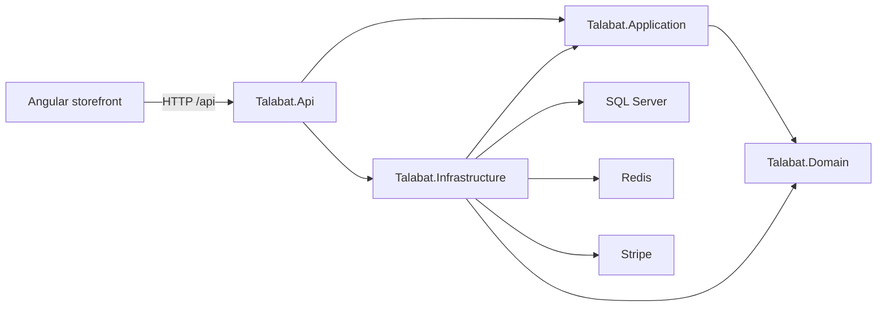
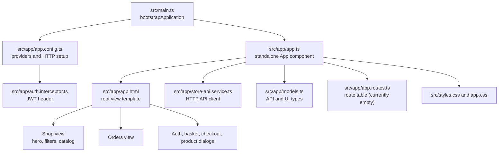
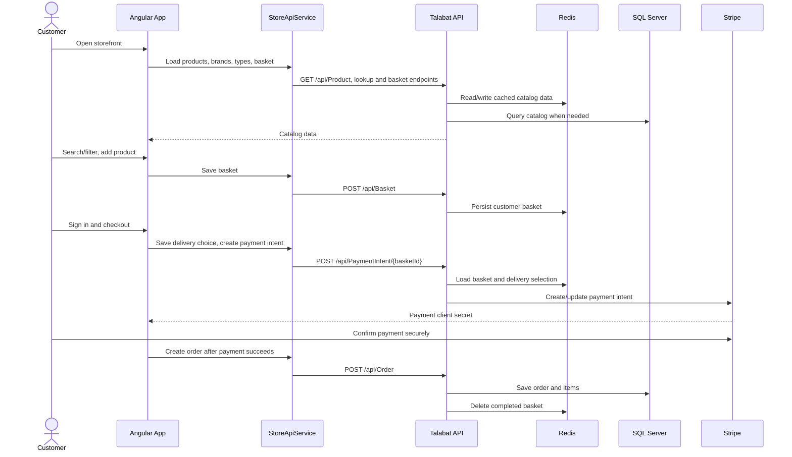

# Talabat architecture and workflows

## Repository hierarchy

```text
Talabat/
├── Backend/
│   ├── Talabat.Api/             HTTP API, authentication, controllers, static images
│   ├── Talabat.Application/     Use cases, DTOs, application services, mapping
│   ├── Talabat.Domain/          Entities, repository contracts, specifications
│   ├── Talabat.Infrastructure/  SQL Server, Redis, Stripe, Identity, repositories
│   └── Talabat.sln
├── Frontend/
│   └── Talabat.Web/             Angular storefront and Nginx proxy
├── compose.yaml                 Docker Compose for API and storefront
├── docs/
└── README.md
```

## Backend dependency hierarchy



The Domain defines business entities and contracts. Application contains use cases and orchestration. Infrastructure implements persistence, caching, identity, and payment integrations. The API composes the layers and exposes HTTP endpoints.

## Current Angular file hierarchy

The current Angular storefront uses one standalone root component. The labels below describe template sections and UI states inside that component; they are not separate Angular components yet.



`app.html` currently owns the shop, orders, and modal templates; `app.ts` owns their state and interactions. The routes file is not yet used for separate pages.

## Store and checkout workflow



## Redis cache in VS Code

Install the recommended **Redis for VS Code** extension (`redis.redis-for-vscode`). Create a connection to the Redis server configured in `ConnectionStrings:Redis` (the local default is `localhost:6379`). The extension browses Redis keys and data types directly; use the app's cache diagnostics endpoint to inspect the keys the API reports. Keep connection passwords out of workspace settings and committed files.

The recommended **Markdown Mermaid** extension (`bierner.markdown-mermaid`) renders the diagrams in VS Code Markdown preview. Open this file and run **Markdown: Open Preview**.
